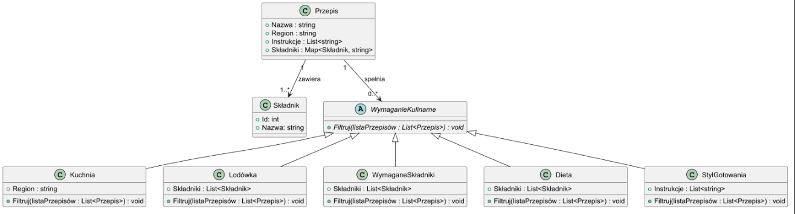

# Diagram klas

```
@startuml

class Składnik {
    +Id: int
    +Nazwa: string
}

class Przepis {
    +Nazwa : string
    +Region : string
    +Instrukcje : List<string>
    +Składniki : Map<Składnik, string>
}

abstract class WymaganieKulinarne {
    + {abstract} Filtruj(listaPrzepisów : List<Przepis>) : void
}

class Kuchnia {
    +Region : string
    +Filtruj(listaPrzepisów : List<Przepis>) : void
}

class Lodówka {
    +Składniki : List<Składnik>
    +Filtruj(listaPrzepisów : List<Przepis>) : void
}

class WymaganeSkładniki {
    +Składniki : List<Składnik>
    +Filtruj(listaPrzepisów : List<Przepis>) : void
}

class Dieta {
    +Składniki : List<Składnik>
    +Filtruj(listaPrzepisów : List<Przepis>) : void
}

class StylGotowania {
    +Instrukcje : List<string>
    +Filtruj(listaPrzepisów : List<Przepis>) : void
}

Przepis "0..*" --> "0..*" WymaganieKulinarne : spełnia
Przepis "0..*" o-- "1..*" Składnik : znajduje się w

WymaganieKulinarne <|-- Kuchnia
WymaganieKulinarne <|-- Lodówka
WymaganieKulinarne <|-- WymaganeSkładniki
WymaganieKulinarne <|-- Dieta
WymaganieKulinarne <|-- StylGotowania

@enduml
```


