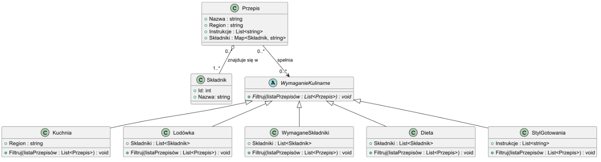

# Diagram klas

```
@startuml

class Składnik {
    +Id: int
    +Nazwa: string
}

class Przepis {
    +Nazwa : string
    +Region : string
    +Instrukcje : List<string>
    +Składniki : Map<Składnik, string>
}

abstract class WymaganieKulinarne {
    + {abstract} Filtruj(listaPrzepisów : List<Przepis>) : void
}

class Kuchnia {
    +Region : string
    +Filtruj(listaPrzepisów : List<Przepis>) : void
}

class Lodówka {
    +Składniki : List<Składnik>
    +Filtruj(listaPrzepisów : List<Przepis>) : void
}

class WymaganeSkładniki {
    +Składniki : List<Składnik>
    +Filtruj(listaPrzepisów : List<Przepis>) : void
}

class Dieta {
    +Składniki : List<Składnik>
    +Filtruj(listaPrzepisów : List<Przepis>) : void
}

class StylGotowania {
    +Instrukcje : List<string>
    +Filtruj(listaPrzepisów : List<Przepis>) : void
}

Przepis "0..*" --> "0..*" WymaganieKulinarne : spełnia
Przepis "0..*" o-- "1..*" Składnik : znajduje się w

WymaganieKulinarne <|-- Kuchnia
WymaganieKulinarne <|-- Lodówka
WymaganieKulinarne <|-- WymaganeSkładniki
WymaganieKulinarne <|-- Dieta
WymaganieKulinarne <|-- StylGotowania

@enduml
```



## Decyzje projektowe 
### Zastosowanie pola Składniki o typie mapy i relacji agregacji między Przepisem i Składnikiem
Składniki istnieją w bazie danych składników bez względu na to czy istnieje przepis, w którym one występują. 
Dlatego postanowiliśmy zastosować relację agregacji zamiast kompozycji, co pokazuje niezależny czas życia tych obiektów.
Mapę stosujemy, bo składnik sam w sobie nie ma pola ilości, może być stosowany w różnych przepisach w różnych ilościach. 
Typ mapy również umożliwi łatwe sprawdzanie czy składnik występuje w przepisie (szybsze niż w przypadku listy) oraz zapewni brak duplikatów składników w przepisie (nie można np. dać raz 200g mąki i drugi raz 100g mąki). 

### Dziedziczenie po abstrakcyjnej klasie WymaganieKulinarne
Zauważyliśmy, że każda z klas: Kuchnia, Lodówka, WymaganeSkładniki, Dieta, StylGotowania mają wspólną cechą, jaką jest możliwość filtrowania przez nie przepisów i to jest ich główne zastosowanie. 
Jego realizacja sprowadzałoby się to do utworzenia w każdej z nich metody Filtruj przyjmującej i modyfikującej odpowiednio listę przepisów. 
Powtarzanie tego samego kodu w różnych miejscach programu utrodniałoby jednak refaktoryzację i debugowanie, a także zagrażałoby niespójnością różnych fragmentów projektu. Zdecydowaliśmy na zastosowanie dziedziczenia po klasie abstrakcyjnej WymaganieKulinarne, posiadającej metodę Filtruj, implementowaną przez klasy potomne. 
Takie rozwiązanie pozwala na uniknięcie powyższych problemów, a także na umożliwienie zastosowania mechanizmu polimorfizmu.

### Klasa Kuchnia opisana tylko przez pole tekstowe
Pojęcie danej kuchni nie sprowadza się tylko do konkretnego rodzaju instrukcji lub składników,
różne kuchnie mogą używać instrukcji lub składników z tego samego zbioru mimo, że są innymi kuchniami.
Z powodu powyższej niejednoznaczności przynależności przepisu do danej kuchni tylko na podstawie tego z jakich instrukcji i składników jest złożony,
postanowiliśmy opisać kuchnię przez oddzielne pole tekstowe, zamiast klasy z polami składniki i instrukcje. 
W związku z tym kuchnia przepisu jest związana bardziej z intencją twórcy niż jego treścią,
więc to użytkownik powinien móc ustawić odpowiednią kuchnię.
