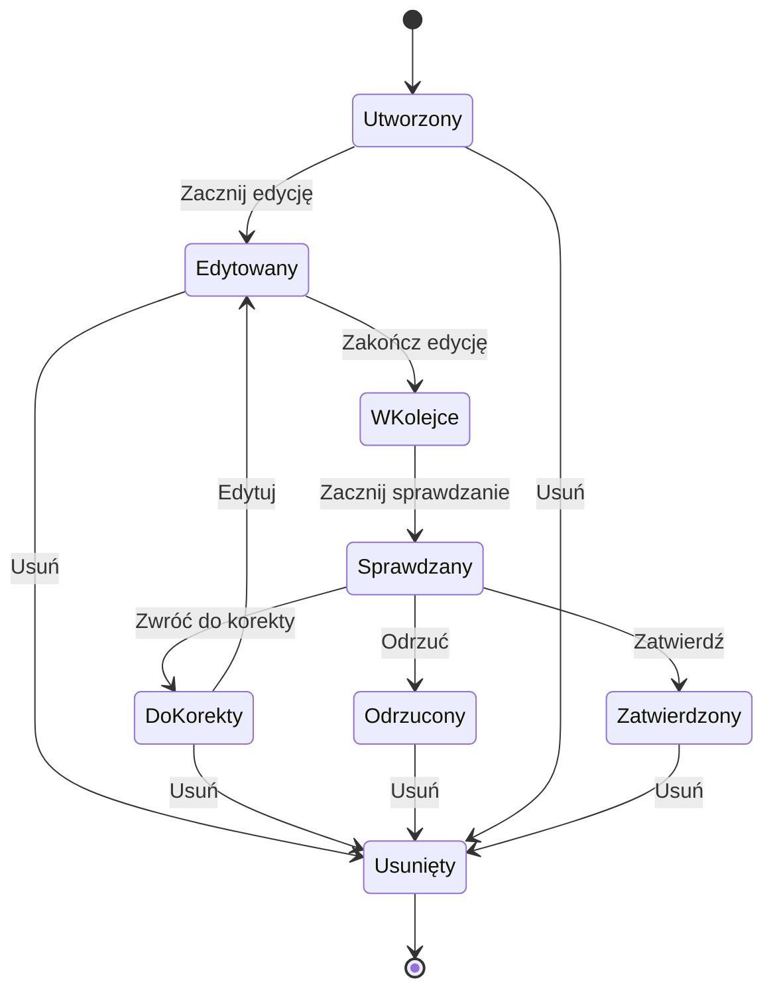

# Diagram stanów

## Decyzje projektowe
### Rozdział stanu Odrzucony i DoKorekty
Rozważyliśmy, co się dzieje w przypadku braku uzyskania zatwierdzenia dla przepisu. 
Pierwsze podejście zakładało przejście od razu do stanu Odrzucony. Uwzględniliśmy jednak sytuację, że przepis jest w zasadzie dobry, ale moderator zgłosił do niego nieliczne uwagi. 
Wówczas moderator może zaznaczyć, które miejsca trzeba poprawić i zmienić stan przepisu na DoKorekty. 
Takie podejście jest korzystne, ponieważ nie zniechęca użytkowników do dodawania przepisów, ale daje szansę na naniesienie poprawek. 
Zapewnia przez to szybszy wzrost ilości danych, zachowując jednocześnie kontrolę nad ich jakością.

### Istnienie stanu Usunięty i przejścia do tego stanu
Utworzyliśmy stan Usunięty po to żeby umożliwić wykonanie odpowiednich akcji systemowych przy usuwaniu przepisu (np. zwalniania pamięci). 
Stan Usunięty również pełni funkcję jedynego stanu końcowego, co zapewnia większą kontrolę nad cyklem życia obiektu - to jedyny stan w którym obiekt przepisu może przestać istnieć. 
Postanowiliśmy nie tworzyć przejść ze stanów WKolejce i Sprawdzany do Usunięty, żeby zabezpieczyć proces moderacji - użytkownik nie może usunąć przepisu w trakcie gdy moderator nad nim pracuje. 
W każdym innym momencie użytkownik dostaje możliwość zdecydować o usunięciu swojego przepisu.

### Rozdział stanu Utworzony i Edytowany
Postanowiliśmy rozdzielić stany Utworzony i Edytowany, by jasno rozróżnić stan, w którym nad przepisem jest wykonywana jakaś praca od stanu nowo utworzonego. 
Dzięki takiemu podziałowi nie usuniemy przepisu w trakcie gdy użytkownik nad nim pracuje, a także możemy rozróżnić przepisy z cyklu sprawdzania od tych nigdy nieedytowanych ułatwiając wybór przepisów do usunięcia w razie ograniczeń pamięciowych.
